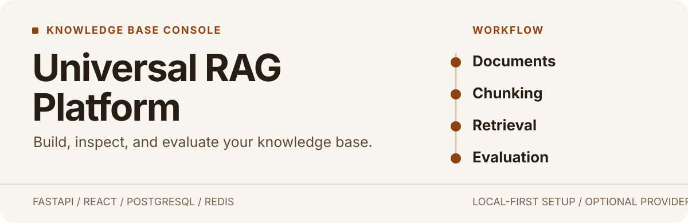
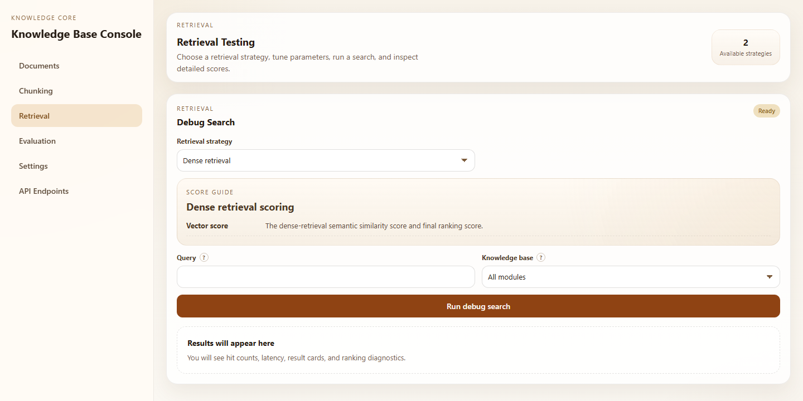
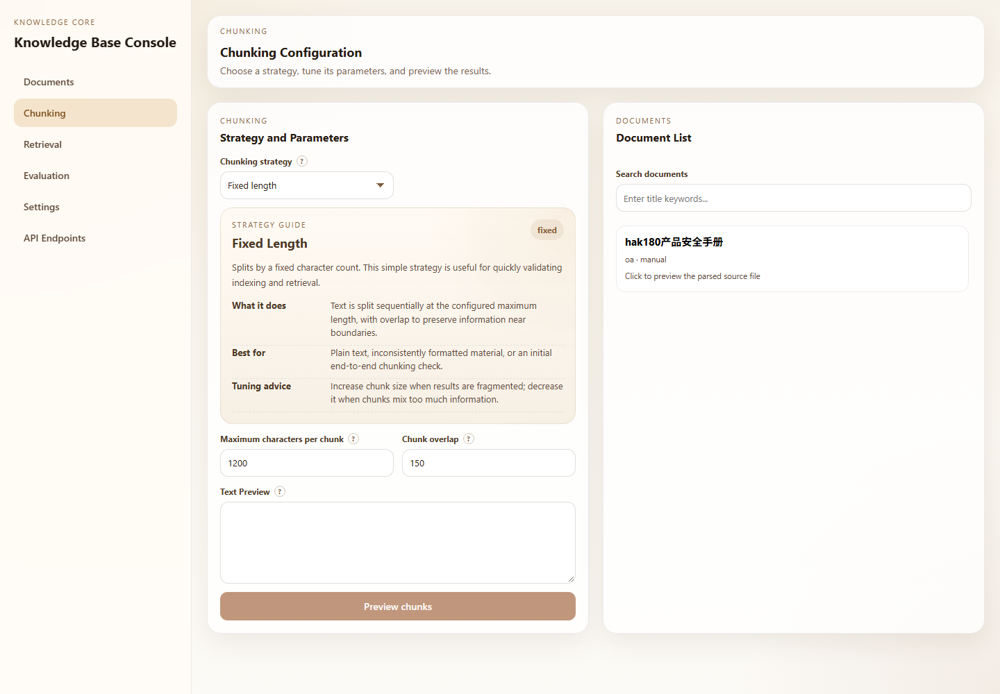
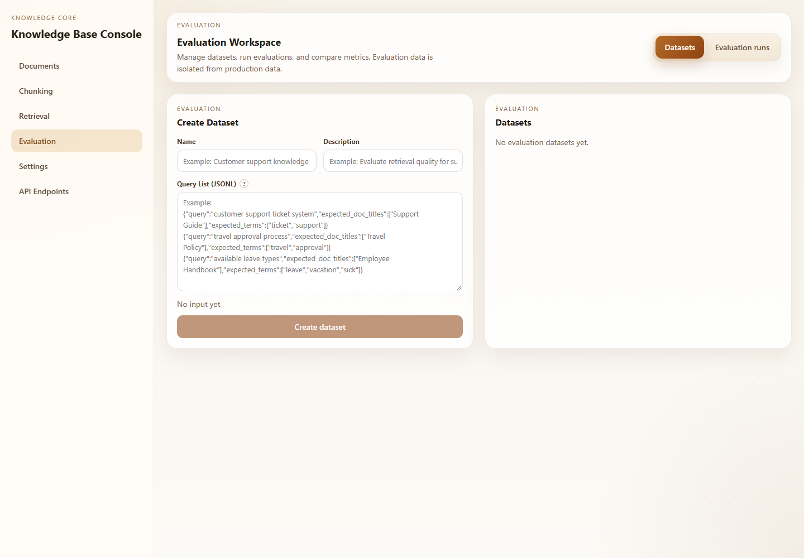
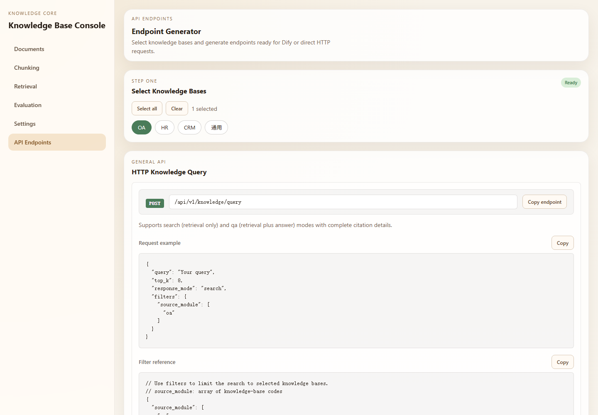

<p align="center">
  
</p>

**Universal RAG Platform** is a FastAPI and React knowledge-base workspace for bringing documents into a RAG pipeline, inspecting how they are split and retrieved, and evaluating retrieval results. It runs with PostgreSQL, Redis, and a local vector store by default; external model and vector providers can be configured when needed.

[Quick start](#quick-start) · [Explore the console](#explore-the-console) · [API access](#api-access) · [Local development](#local-development)

## See what retrieval is doing

The retrieval console lets you choose dense or hybrid search, tune parameters, and inspect per-query ranking diagnostics. This is an actual screen from the project.



## Explore the console

The workspace follows the path from source material to measured retrieval:

1. **Manage documents.** Bring source material into a knowledge base and track ingestion.
2. **Preview chunking.** Select a strategy, adjust parameters, and inspect the resulting splits before indexing.
3. **Debug retrieval.** Compare dense and hybrid strategies and inspect scores and ranking details.
4. **Evaluate.** Build reusable query datasets and compare retrieval quality and latency across runs.

### Preview chunking



<details>
<summary>View the evaluation workspace</summary>



</details>

## Quick start

You need Docker Desktop with Linux containers enabled. From the repository root, run:

```sh
docker compose up --build -d
```

The first start builds the backend and frontend, starts PostgreSQL and Redis, applies Alembic migrations, and opens the console.

| Open | Address |
| --- | --- |
| Web console | http://localhost:8080 |
| API documentation | http://localhost:18080/docs |
| Health check | http://localhost:18080/api/v1/health |

Start in the web console: add a knowledge base and document, preview chunking, then run a search in **Retrieval**. The Compose defaults use the local vector store and provider fallbacks, so external embedding, LLM, reranking, image-recognition, and Milvus/Zilliz services are optional for a local start.

To change ports, credentials, or providers, copy `.env.example` to `.env` and edit it before starting. Keep `.env` out of Git. The checked-in Compose credentials and API key are development defaults; change them before exposing a deployment beyond your local machine.

```sh
docker compose logs -f backend frontend  # follow application logs
docker compose ps                        # inspect services
docker compose down                      # stop, retain data volumes
```

`docker compose down -v` also deletes the local database and storage volumes.

## API access

The console can generate request examples for the native HTTP API and Dify integration, including knowledge-base selection. The native query endpoint is `POST /api/v1/knowledge/query`; its `response_mode` accepts `search` for retrieval or `qa` for retrieval plus an answer. See the live schema at [API documentation](http://localhost:18080/docs) after startup.



## Local development

The project pins Python **3.11.13** in `.python-version`. For a Windows PowerShell environment, with PostgreSQL and Redis running:

```powershell
py -3.11 -m venv .venv
.\.venv\Scripts\Activate.ps1
python -m pip install --upgrade pip
pip install -r requirements.txt
Copy-Item .env.example .env
# Edit .env to match your local PostgreSQL and Redis settings.
alembic upgrade head
uvicorn app.main:app --reload --host 127.0.0.1 --port 18080
```

In a second terminal:

```powershell
Set-Location frontend
npm ci
npm run dev
```

Vite serves the frontend at http://localhost:5180 and proxies `/api/v1` to the backend. Application settings live in `app/core/config.py`; `.env.example` lists the supported local and Compose settings. A local backend needs `DATABASE_URL` or the PostgreSQL connection values.

## Tests and project map

Install pytest in the active Python environment and run `pytest`.

```text
app/          FastAPI application and RAG services
frontend/     React/Vite console
migrations/   Alembic database migrations
scripts/      Smoke and acceptance scripts
tests/        Backend test suite
```
